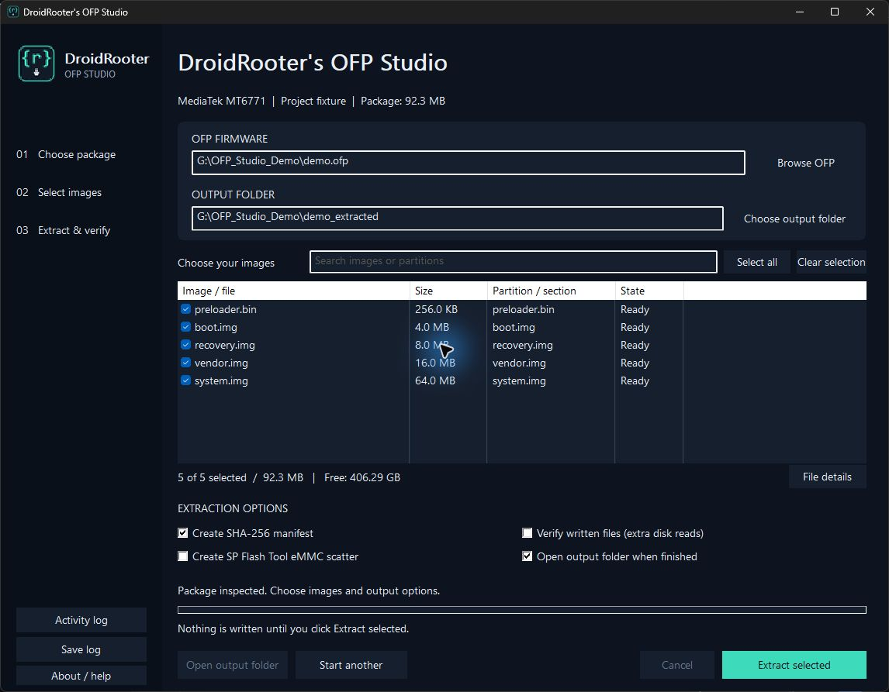

# DroidRooter's OFP Studio

**A portable Windows GUI for extracting OPPO and realme OFP firmware. Written in C.**

[Download the Windows EXE](https://github.com/saadnahid7/droidrooter-ofp-studio/releases/latest)
· [Qualification and limits](docs/qualification.md) · [MIT license](LICENSE)



No Python installation, terminal commands, separate runtime, drivers or external
extraction tools are needed to use the app. Download `DroidRooter-OFP-Studio.exe` and open it.
Runs on Windows 10/11 x64 with normal user permissions. The binary is unsigned.

## What you can do

- **Browse OFP** with a native file dialog, enter its path, or drag it into the window.
- **Choose output folder** with a separate native folder picker or enter a new path.
- Inspect package type, file names, partition labels and image sizes before writing.
- Tick individual images, search the list, select all, or clear the selection.
- See selected file count, required output size and available destination space.
- Generate SHA-256 checksums and a logical-partition report; optionally reread written files for verification.
- Generate a separate conventional SP Flash Tool eMMC scatter from eligible OEM layouts.
- Track progress, throughput, elapsed time and estimated time remaining; cancel safely.
- View image details, open the output folder, view/save the activity log, or start again.

Filtering keeps selections outside the visible results. The selected count always
includes hidden rows. **Select all** and **Clear selection** apply to the entire package.

## Quick start

1. Open **DroidRooter-OFP-Studio.exe** and choose **Browse OFP**.
2. Choose an output folder. A new folder is recommended: existing files are never overwritten.
3. Select the images you need. All files start selected.
4. Choose manifest, readback verification and scatter options.
5. Click **Extract selected**. Open the result folder when the operation finishes.

Cancellation removes the current owned partial file and retains completed images.
Choose a fresh destination for another run; v1 does not resume or overwrite files.

## Supported formats and limits

| Format | Support | Qualification |
| --- | --- | --- |
| MediaTek raw OFP, known upstream key profiles | Inspect, select and extract | Real OPPO F15 CPH2001 C.53 plus synthetic fixtures |
| Qualcomm raw OFP, known upstream key profiles, 512/4096-byte pages | Inspect, select and extract | Synthetic fixtures; no real Qualcomm firmware qualification yet |
| OEM V2.1.0 MediaTek eMMC scatter | Optional V1.1.2 compatibility copy | Real F15 and sparse-image fixtures |
| ZIP-wrapped OFP, ordinary ZIP, OnePlus OPS | Not supported | Explicit rejection |
| Unknown keys/formats | Not supported | Actionable error; no guessed decryption |

Output folders must be on a local drive. Junctions, symbolic links, other reparse
points, unsafe archive paths and conflicting duplicate names are rejected. Identical
duplicate logical entries share a single output file.

### Scatter generation

The original OEM scatter and firmware bytes are preserved. The optional compatibility
copy uses only the eMMC section and disables preloader downloading. All referenced
images must be extracted and fit their partition sizes; Android sparse images are
checked using their expanded sizes. Ineligible scatter conversion is reported
separately in the status and activity log; extraction can still succeed.

This app does not flash a phone or provide a Download Agent. A generated scatter
does not establish phone compatibility, authentication acceptance or SP Flash Tool
UI compatibility. No physical flashing is part of qualification.

### Verification

`SHA256SUMS.txt` records hashes generated from decrypted output. `OFP-Studio-report.txt` retains logical partition labels, including aliases that share an identical image. Optional **Verify
written files** rereads each file and compares it with the extraction hash.
Qualcomm vendor checksums are checked separately when supplied, preserving upstream
conventions: SHA-256 may cover the full image or the first 256 KiB; MD5 covers the
first 256 KiB; a match from an available vendor checksum is accepted. Newly generated
hashes do not authenticate firmware provenance.

## Native implementation

C11, Win32/common controls, Windows CNG (AES/MD5/SHA-256), XMLLite and native shell
dialogs. Extraction uses a worker thread, 64-bit file offsets and a bounded 4 MiB
stream buffer. No Electron, webview, Python, bundled crypto library or external
executable is used at runtime. See [measured qualification](docs/qualification.md)
for correctness, performance and DLL dependency evidence.

## Build from source

Development requires a Windows C compiler, CMake and Ninja; these are **build-time**
tools, not dependencies for people downloading the EXE. The tested toolchain is
MinGW-w64 GCC 14.2 (UCRT).

```powershell
.\build.ps1
```

The GUI is `build/OFPStudio.exe`. `build/ofp-test.exe` is a development test driver,
not part of the user distribution. Python is used only for development fixtures:

```powershell
python -m pip install -r requirements-dev.txt
python tests/test_engine.py
```

To test a different build, set `OFP_TEST_DRIVER` to its `ofp-test.exe` path. Windows
CI builds the app, runs the fixture suite and uploads the portable EXE.

## Credits

Based on [Bjoern Kerler's oppo_decrypt](https://github.com/bkerler/oppo_decrypt).
See [third-party notices](THIRD_PARTY_NOTICES.md) for adapted format logic and credits.
This project is not affiliated with OPPO, realme, OnePlus or MediaTek.
